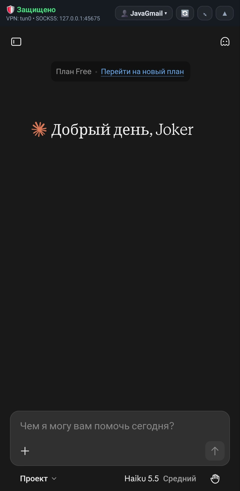
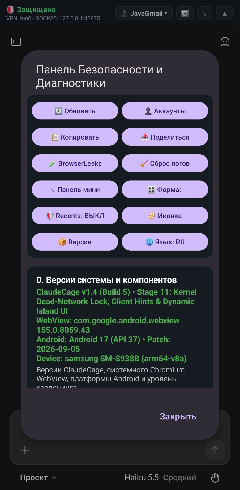
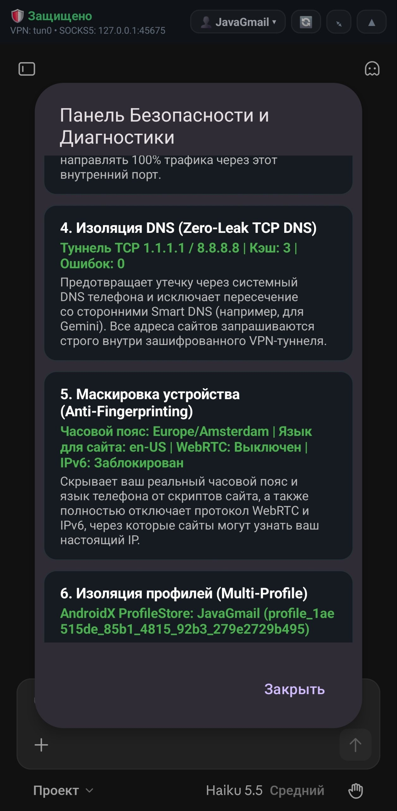
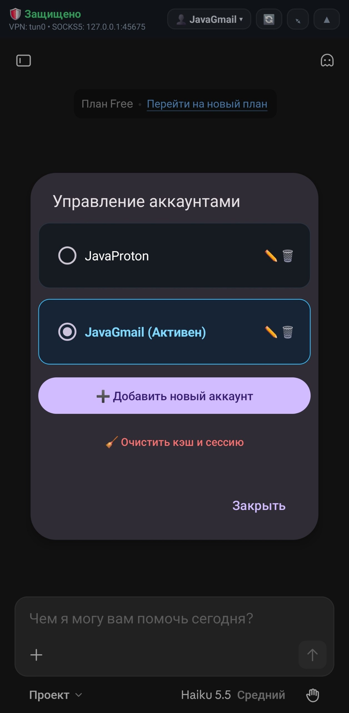
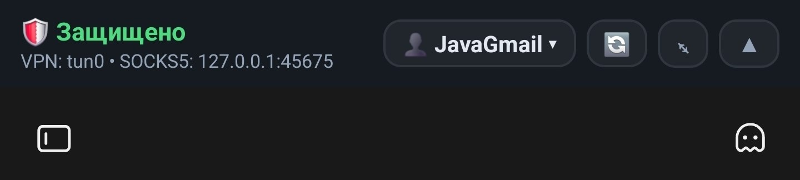
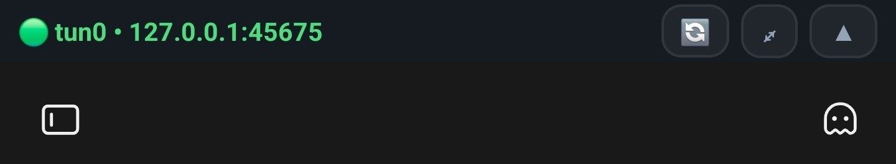
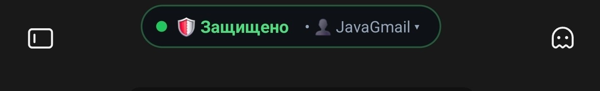
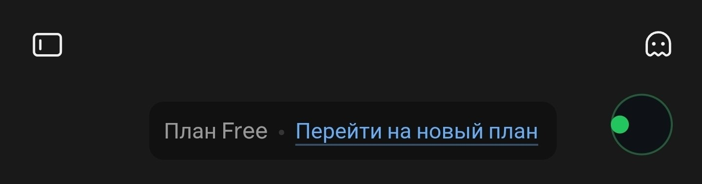
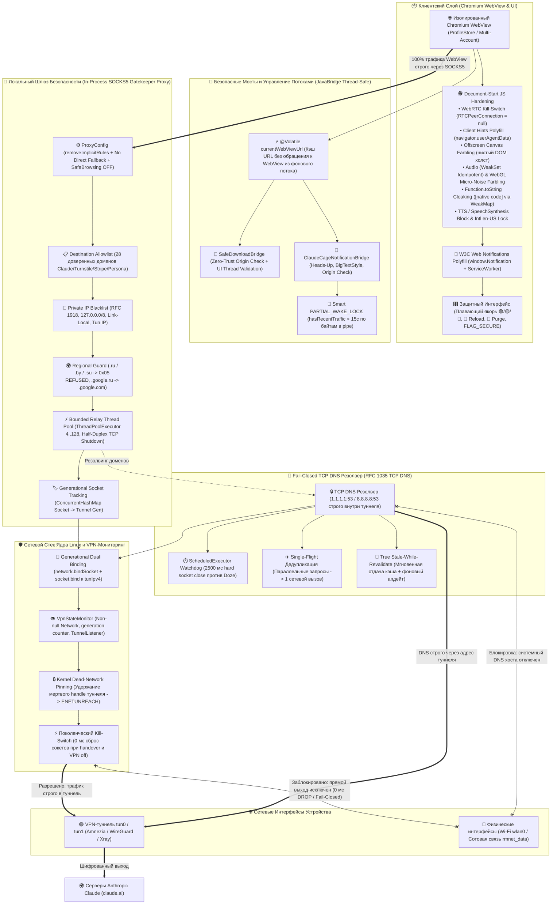

# ClaudeCage 🛡️
### Android Zero-Trust Security Cage for Anthropic Claude

[-3DDC84.svg?style=flat&logo=android)](https://developer.android.com)
[-blue.svg?style=flat)]()
[]()
[]()
[]()

**ClaudeCage** — это бескомпромиссный, аппаратно изолированный Android-контейнер для веб-интерфейса [Anthropic Claude](https://claude.ai), построенный по принципу **Strict Fail-Closed Zero-Leak**.

Приложение решает ключевую проблему мобильной безопасности: предотвращение утечек реального сетевого окружения (IP-адреса, системных DNS, геолокации, часового пояса, системного языка и аппаратного фингерпринтинга устройства) при работе через VPN (Amnezia VPN Premium: протоколы WireGuard, Awg, Xray). При малейшем сбое, реконнекте или падении VPN-туннеля любой трафик мгновенно отсекается на уровне сокетов ядра Linux — выход в открытую сеть через Wi-Fi или сотовую связь физически невозможен.

---

## 📸 Скриншоты и Визуальный Интерфейс (Screenshots & UI Showcase)

### 1. Защищённый Веб-Интерфейс Claude и Панель Диагностики
| Главный экран Claude.ai в ClaudeCage | Панель безопасности и 2-колоночная сетка действий |
| :---: | :---: |
|  |  |
| *Главный экран с защищённым веб-интерфейсом Claude, тонкой верхней панелью статуса и переключателем профилей* | *Компактная сетка из 12 быстрых действий (BrowserLeaks, профили, сброс кэша, смена языка/иконки) и верификация компонентов* |

### 2. Zero-Leak Телеметрия и Изоляция Мульти-Аккаунтов
| Мониторинг безопасности и телеметрии | Управление аккаунтами (Multi-Profile) |
| :---: | :---: |
|  |  |
| *Карточки аудита в реальном времени: Fail-Closed TCP DNS (1.1.1.1/8.8.8.8), Anti-Fingerprinting (Amsterdam / en-US), изоляция профилей* | *Независимая контейнеризация аккаунтов (AndroidX ProfileStore + AES-256-GCM Keystore fallback) и быстрая очистка кук* |

### 3. Адаптивная Верхняя Панель и Плавающий Якорь Морфинга
| Верхняя панель: Стандартный режим (42dp) | Верхняя панель: Ультратонкий режим (26dp) |
| :---: | :---: |
|  |  |
| *Развёрнутый статус: интерфейс tun0, SOCKS5-порт, активный профиль и кнопки управления* | *Минималистичный компактный индикатор: оставляет максимум полезной высоты для чата* |

| Плавающий якорь: Форма «Капсула» (Pill) | Плавающий якорь: Форма «Круг» (Circle) |
| :---: | :---: |
|  |  |
| *Динамический остров с неоновой границей статуса (🟢/🟡/🔴), монограммой профиля и быстрым разворачиванием* | *Сверхкомпактный круговой якорь 34x34dp со статусной точкой по центру и жестами pinch/double-tap* |

---

## 🚀 1. Как устроен ClaudeCage v1.5 и почему это круто

Внутри **ClaudeCage v1.5 (Stage 11: Production Ready)** реализована глубокая эшелонированная оборона. Вместо стандартного Android WebView, где происходят фоновые утечки через Google Safe Browsing, WebRTC, сторонние DNS и неявные правила обхода прокси, в ClaudeCage трафик движка замкнут на локальный сетевой шлюз ядра, защищён криптографическим резолвером и маскируется стелс-скриптами:



---

## ⚡ 2. Ключевые Возможности и Архитектурные Инварианты

### 🔒 1. 100% SOCKS5 Proxy Override & Anti-Bypass
* **Тотальная маршрутизация:** весь трафик Chromium WebView принудительно направляется на локальный шлюз `127.0.0.1:<ephemeral_port>` через `ProxyController.getInstance().setProxyOverride(...)`.
* **Запрет Fallback:** режим прямого соединения исключён (`isDirectFallbackDisallowed = true`).
* **Анти-обход (Anti-Bypass):** применён метод `.removeImplicitRules()`, отключающий стандартные неявные правила Chromium, разрешающие сайтам прямой опрос `localhost` и `127.0.0.1`.
* **Ампутация SafeBrowsing:** вызов `WebSettingsCompat.setSafeBrowsingEnabled(settings, false)` гарантирует отсутствие внепроксийных фоновых запросов браузерного движка к серверам Google.
* **Строгий Cleartext запрет:** `android:usesCleartextTraffic="false"` в манифесте исключает открытую передачу HTTP-пакетов.

### 🛡️ 2. Белый Список Назначений (Destination Allowlist) & Фильтр Приватных IP
* **Zero-Trust Allowlist:** разрешены исключительно **28 проверенных доменов**, необходимых для полноценной работы экосистемы Claude, биллинга и верификации:
  - **Сервисы Anthropic:** `claude.ai`, `anthropic.com`, `claude.com`.
  - **Верификация личности (KYC / Identity Verification):** `withpersona.com`, `persona.com` *(требуется при оформлении и оплате подписок Claude Pro / Team)*.
  - **Антифрод и сетевая защита:** `cloudflare.com`, `hcaptcha.com`.
  - **Биллинг и платёжный шлюз:** `stripe.com`, `stripe.network`, `stripecdn.com`, `stripe.link` *(Stripe Link 1-click checkout)*.
  - **Клиентский чат и CDN:** `intercom.io`, `intercomcdn.com`.
  - **Телеметрия сервиса:** `statsig.com`, `statsigapi.net`, `datadoghq.com`, `sentry.io`.
  - **Google OAuth / Аватары:** `google.com`, `gstatic.com`, `googleapis.com`, `googleusercontent.com`, `youtube.com`.
  - **Apple ID авторизация:** `apple.com`, `appleid.apple.com`.
  - **Диагностика безопасности:** `browserleaks.com`, `browserleaks.net`, `browserleaks.org`, `ripe.net`.
  - *Все сторонние домены мгновенно отвергаются кодом `0x05 (Connection Refused)`.*
* **Кнопка быстрого возврата (`btnReturnToClaude`):** при переходе на страницы верификации Persona, оплаты Stripe или тестов BrowserLeaks автоматически отображается кнопка «⬅️ Вернуться в Claude», скрывающаяся при возврате на `claude.ai`.
* **Private IP Blacklist (`isForbiddenIp`):** полностью запрещены подключения к loopback (`127.0.0.0/8`), link-local (`169.254.0.0/16`), RFC 1918 приватным сетям (`10.0.0.0/8`, `172.16.0.0/12`, `192.168.0.0/16`) и локальному IP самого tun-адаптера.
* **Региональный фильтр:** домены СНГ (`.ru`, `.su`, `.by`, `.рф`) блокируются немедленно (`0x05`), а запросы к `.google.ru` прозрачно переписываются на `.google.com`. IPv6 (`ATYP 0x04`) отклоняется ответом `0x08`.

### ⚡ 3. Kernel Dead-Network Lock & Поколенческий Двойной Kill-Switch
* **Kernel Dead-Network Pinning (Stage 11):** при обрыве или падении VPN вызов `bindProcessToNetwork(null)` исключён. Процесс намеренно остаётся привязанным к дескриптору умершей сети туннеля (dead network handle). Ядро Linux на уровне системных вызовов сокетов немедленно отсекает любые попытки выхода пакетов наружу с системным кодом ошибки `ENETUNREACH`, делая физически невозможной утечку данных в сотовую сеть или Wi-Fi даже при сбоях сервисов Android Framework.
* **Generational Socket Binding:** каждый исходящий TCP-сокет связывается с сетевым стеком туннеля в два этапа:
  1. `network.bindSocket(socket)` — привязка к системному NetID туннеля VPN.
  2. `socket.bind(InetSocketAddress(tunIpv4, 0))` — аппаратная привязка IP источника к IPv4 адресу tun-интерфейса.
* **Синхронный `TunnelListener`:** при разрыве VPN или смене туннеля (handover) синхронно закрываются все сокеты устаревших поколений (`gen < currentGeneration`), предотвращая утечки данных в открытые физические интерфейсы (`wlan0` / `rmnet_data`).
* **Relay Anti-Starvation & Bounded Thread Pool:** передача трафика вынесена на выделенный ограниченный пул потоков `relayExecutor = ThreadPoolExecutor(4, 128, 60s, SynchronousQueue())` с потоками-демонами. Это исключает OOM-риски при шторме сокетов и не расходует корутинный пул `Dispatchers.IO` (лимит 64 потока). По завершении передачи данных применяется полудуплексное закрытие TCP (`shutdownOutput()` / `shutdownInput()`).

### 📡 4. Fail-Closed TCP DNS (RFC 1035) с Scheduled Watchdog, True SWR и Single-Flight
* **Изолированный DNS:** системный DNS Android полностью игнорируется. Все DNS-запросы направляются по протоколу TCP через туннель на `1.1.1.1:53` (primary) и `8.8.8.8:53` (fallback).
* **Scheduled Watchdog:** сторожевой таймер на базе `ScheduledExecutorService` жёстко обрывает зависший сокет ровно через `2500 мс`, предотвращая freeze при выходе из Doze-режима.
* **Single-Flight Дедупликация:** параллельные запросы к одному домену объединяются в один сетевой запрос, исключая лавинообразные DNS-штормы.
* **True Stale-While-Revalidate (SWR):** при истечении TTL запись немедленно отдаётся из stale-кэша, а обновление выполняется асинхронно в фоне. Stale-кэш сохраняется при кратковременных падениях VPN.

### 🔔 5. W3C Web Notifications API & Потокобезопасный Нативный Шлюз
* **W3C Polyfill в Document-Start JS:** системный Android WebView не поддерживает стандартный браузерный API `window.Notification`. В ClaudeCage внедрён полный полифилл конструктора `Notification`, статических геттеров и воркеров (`ServiceWorkerRegistration.prototype.showNotification`).
* **Маскировка WeakMap:** все переопределённые методы замаскированы под нативный движок Chromium (`[native code]`).
* **Нативный Шлюз (`ClaudeCageNotificationBridge.kt`):**
  - Поддержка рантайм-разрешений Android 13+ (`POST_NOTIFICATIONS`).
  - Выделенный канал `IMPORTANCE_HIGH` с вибрацией и всплывающими Heads-Up уведомлениями.
  - Раскрывающийся текст ответа в шторке (`NotificationCompat.BigTextStyle`).
  - Двусторонняя маршрутизация клика по уведомлению в чат через `onNewIntent` $\to$ `window.__dispatchNotificationClick(id)`.
* **JavaBridge Thread Safety:** URL активной вкладки кэшируется в `@Volatile currentWebViewUrl` в UI-коллбэках, исключая `RuntimeException: A WebView method was called on thread 'JavaBridge'` при межпоточных проверках Origin.

### 🔋 6. Интеллектуальный Фоновый Режим (Smart WakeLock)
* **Проблема cgroup freezer:** при сворачивании приложения Android замораживает процесс через 10–30 секунд, обрывая входящий SSE-поток генерации ответа Claude.
* **Решение:** в `MainActivity.onStop()` фоновый `PARTIAL_WAKE_LOCK` захватывается только при наличии свежего трафика через прокси за последние 15 секунд (`hasRecentTraffic(15_000L)` на базе отслеживания байтов в `pipe()`). Если приложение свернуто в покое — процессор мгновенно засыпает без расхода батареи.

### 🕵️ 7. Глубокий Anti-Fingerprint Hardening & Client Hints
* **POSIX & JVM:** `setenv("TZ", "Europe/Amsterdam", 1)`, `TimeZone.setDefault("Europe/Amsterdam")`, `Locale.setDefault(Locale.US)`, `LocaleList.setDefault(LocaleList(Locale.US))`.
* **Client Hints Polyfill:** внедрён полифилл `navigator.userAgentData` (бренды Chromium / Google Chrome, платформа Android, модель `SM-S938B`, динамическая маскировка версии движка).
* **Audio & WebGL Micro-Noise Farbling:** инжекция детерминированного микрошума в `AudioBuffer.prototype.getChannelData` (`1e-7 * NOISE_OFFSET` с защитой идемпотентности через `WeakSet`) и `WebGL(2)RenderingContext.prototype.readPixels`.
* **WebRTC Kill-Switch:** полное удаление `RTCPeerConnection`, `webkitRTCPeerConnection`, `RTCDataChannel`, `getUserMedia`.
* **Offscreen Canvas Farbling:** наложение детерминированного псевдослучайного шума на базе `profileSeed` при вызовах `getImageData`, `toDataURL` и `toBlob`. При конвертациях в PNG/Blob шум генерируется на **временном оффскрин-холсте**, исключая порчу видимого DOM-холста страницы.
* **Маскировка `toString()`:** замена `Function.prototype.toString` зарегистрирована в `WeakMap`, благодаря чему `Function.prototype.toString.toString()` и все перехваченные методы возвращают честный `[native code]`.
* **Ампутация TTS:** `speechSynthesis.getVoices = () => []` блокирует определение установленных системных русских голосовых движков.
* **Фиксация окружения:** `Intl.*` зафиксирован на `en-US`, `hardwareConcurrency = 8`, `deviceMemory = 8`, `navigator.webdriver = false`, `navigator.connection.onchange = null`.

### 👥 8. Многопрофильность и Управление Сессией
* **Multi-Account Контейнеризация:** независимые сессии через современный AndroidX `ProfileStore` (`getOrCreateProfile(storageKey)`).
* **Аппаратный Keystore Fallback:** резервный CookieJar с AES-256-GCM шифрованием (автоматическая генерация IV аппаратным провайдером `AndroidKeyStore`, привязка AAD к `profileId`).
* **Комплексный сброс сессии (`btnPurgeSession` 🧹):** точечная очистка `ProfileStore`, кэша WebView и аппаратных Keystore-кук без удаления профиля.
* **Быстрая перезагрузка (`btnReload` 🔄):** кнопка обновления страницы в статусной панели при залипании интерфейса.
* **Privacy Screen (`FLAG_SECURE`):** защита содержимого чатов от снимков экрана и превью в недавних приложениях Android.

### 🎨 9. Динамический Морфинг Якоря и Ультратонкая Панель (Stage 11 UI)
* **Ультратонкая верхняя панель:** переключение между стандартным режимом (42dp) и ультратонким (26dp), освобождающим драгоценное пространство экрана для диалогов Claude.
* **Плавающий динамический якорь безопасности:** морфинг между тремя формами:
  - `PILL` — полная капсула со статусом туннеля и именем профиля.
  - `SQUARE` (38x38dp) — компактный скруглённый квадрат со статусной точкой и монограммой аккаунта.
  - `CIRCLE` (34x34dp) — сверхкомпактный круговой индикатор со статусной точкой.
* **Жестовое управление и свободное перемещение:** мультитач двумя пальцами (pinch-in уменьшает форму, spread-out увеличивает форму), двойной тап одним пальцем (дебаунсинг 260 мс), горизонтальный свайп/флинг и фиксация в произвольной позиции экрана с отступом 4dp без принудительного прилипания к краям.
* **Неоновая подсветка границы:** цвет рамки плавающего островка динамически отражает статус VPN (🟢 `#554ADE80` защищено, 🟡 `#88FBBF24` переходное состояние, 🔴 `#99F87171` заблокировано).
* **2-Колоночная сетка быстрых действий:** диалог диагностики содержит 12 быстрых переключателей (BrowserLeaks, сброс логов, динамическая смена формы с отображением активного режима, Recents, иконка, язык интерфейса).

---

## 📂 3. Структура Проекта и Карта Компонентов

```text
ClaudeCage/
├── app/src/main/java/com/example/claudecageand/
│   ├── ClaudeCageApp.kt                      # Application: синглтоны, POSIX TZ, JVM Locale, LocaleList
│   ├── MainActivity.kt                       # Главная Activity: WebView, профили, плавающий якорь, Card UI, JavaBridge safety
│   ├── accounts/
│   │   ├── AccountProfile.kt                 # Модель данных профиля: id, displayName, storageKey, profileSeed
│   │   ├── AccountProfileManager.kt          # Менеджер профилей: переключение, добавление, удаление, StateFlow
│   │   ├── AccountProfileJsonCodec.kt        # JSON сериализация профилей на org.json
│   │   └── AccountCookieJarFallback.kt       # Fallback CookieJar: AES-256-GCM (AndroidKeyStore auto-IV + AAD)
│   ├── net/
│   │   ├── TunnelDnsResolver.kt              # TCP DNS: ScheduledExecutor watchdog, True SWR, Single-Flight
│   │   ├── VpnGatekeeperProxy.kt             # SOCKS5 шлюз: Allowlist 28 доменов, private IP filter, bounded relay thread pool
│   │   ├── VpnStateMonitor.kt                # Мониторинг VPN: non-null Network, dead-network pinning, generation counter
│   │   └── VpnTunnelState.kt                 # Модели состояний: Connected (tunIpv4, generation) vs Disconnected
│   ├── notifications/
│   │   └── ClaudeCageNotificationBridge.kt   # W3C Web Notification Bridge: JS-bridge, origin check, heads-up системные уведомления
│   ├── security/
│   │   └── AntiFingerprintHardener.kt        # Document-Start JS: WebRTC Kill, Client Hints, offscreen Canvas, Audio/WebGL noise (WeakSet)
│   ├── telemetry/
│   │   └── SecurityAuditLogger.kt            # Логгер безопасности, кольцевой буфер (500 записей), экспорт Markdown-отчётов
│   └── ui/
│       ├── AppIconManager.kt                 # Динамическая смена иконки (activity-alias)
│       ├── AppIconOption.kt                  # Варианты иконки приложения
│       ├── UiLanguage.kt                     # Enum языков: RU, EN
│       ├── UiLanguageManager.kt              # Менеджер языка интерфейса
│       └── UiStrings.kt                      # Двуязычный строковый каталог
├── screens/                                  # Актуальные скриншоты интерфейса ClaudeCage v1.5
└── app/src/test/                             # 64 модульных теста (DNS, SOCKS5, AntiFingerprint, Profiles, Bridge)
```

---

## 🛠️ 4. Сборка Проекта и Запуск Тестов

### Системные требования:
* **Android SDK:** Compile & Target SDK: 36 (Android 16/17+), Min SDK: 33 (Android 13+)
* **JDK:** 17+
* **Gradle:** 9.3+ (включён Gradle Wrapper)

### Основные команды:

```bash
# 1. Запуск полного набора из 64 модульных тестов:
./gradlew testDebugUnitTest

# 2. Сборка готового Debug APK:
./gradlew assembleDebug

# 3. Полный цикл (верификация тестов + автоматическая сборка APK в корень):
./gradlew testDebugUnitTest assembleDebug
```

> [!NOTE]
> Скрипт сборки Gradle автоматически именует и сохраняет актуальный бинарник **прямо в корень проекта**:
> **`ClaudeCage-1.5.apk`** (устаревшие версии удаляются автоматически).

---

## 📚 5. Архитектурная База Знаний и Документация

* [**`GEMINI.md`**](file:///home/milk13/IdeaProjects/ClaudeCageAnd/GEMINI.md) — Полная самодостаточная модель системы, архитектурный справочник и инварианты кодовой базы для ИИ-агентов.
* [**`SECURITY_AUDIT.md`**](file:///home/milk13/IdeaProjects/ClaudeCageAnd/SECURITY_AUDIT.md) — Подробный отчет архитектурного аудита безопасности с верификацией всех механизмов харденинга.
* [**`AUDIT_REPORT_ARGON4.md`**](file:///home/milk13/IdeaProjects/ClaudeCageAnd/AUDIT_REPORT_ARGON4.md) — Комплексный отчет и полный манифест исходного кода для анализа моделями глубокого рассуждения (Gemini Argon 4 / Claude 3.5 Sonnet).

---

## ⚖️ Лицензия и Отказ от Ответственности
Проект разработан исключительно в образовательных целях и для защиты конфиденциальности персональных данных в исследовательской среде информационной безопасности.
